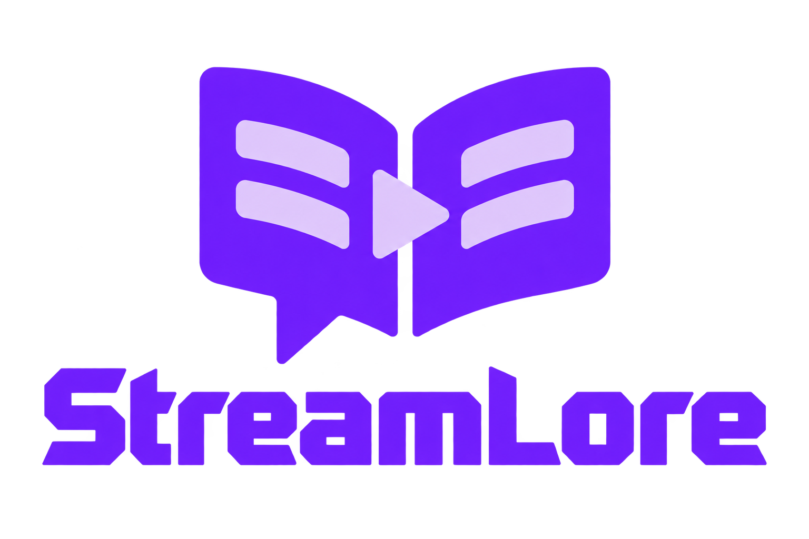
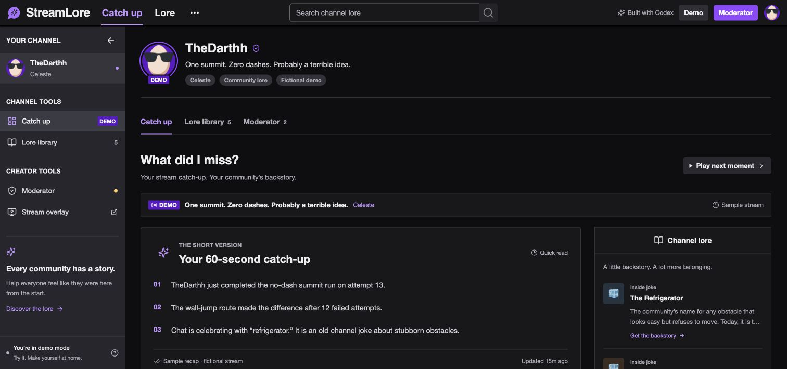
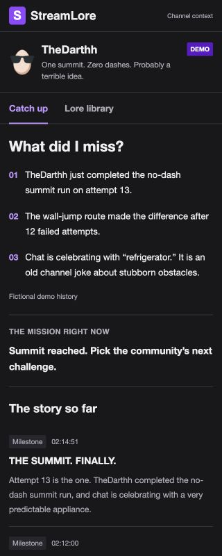
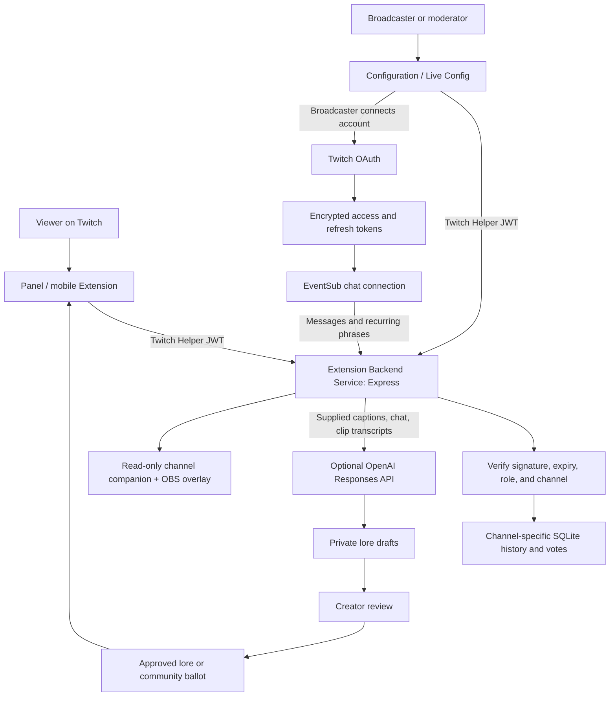

<p align="center">
  
</p>

<h1 align="center">StreamLore</h1>

<p align="center"><strong>What did I miss? What does that mean?</strong><br>Catch up on the stream. Get in on the joke. Feel part of the community.</p>

<p align="center">
  <a href="LICENSE"></a>
  
  
  
  
</p>

Built for the **[Codex × TwitchCon Hackathon](https://twitchcon-codex.devpost.com/)**. StreamLore gives streamers fewer repeated explanations and gives new viewers a way into the conversation: a recap of the current stream and a lasting library of channel lore.

**Status: working local prototype; native Twitch Extension is registered and prerelease.** The companion app, panel/mobile views, creator controls, authentication, and upload builder are implemented. Public HTTPS hosting, separate OAuth application setup, Hosted Test, review, and release are still required before ordinary streamers can install it. Local tests do not establish a live Twitch installation.

<p align="center">
  <a href="#getting-started">Run the demo</a> ·
  <a href="#add-to-a-twitch-channel">Add to Twitch</a> ·
  <a href="docs/twitch-extension-launch.md">Launch guide</a> ·
  <a href="#demo-walkthrough">Demo walkthrough</a>
</p>

## Contents

- [Why StreamLore exists](#why-streamlore-exists)
- [What the project implements](#what-the-project-implements)
- [See it in action](#see-it-in-action)
- [Architecture and trust boundaries](#architecture-and-trust-boundaries)
- [How a moment becomes channel lore](#how-a-moment-becomes-channel-lore)
- [Add to a Twitch channel](#add-to-a-twitch-channel)
- [Getting started](#getting-started)
- [Runtime modes and configuration](#runtime-modes-and-configuration)
- [Twitch chat integration](#twitch-chat-integration)
- [Captions, clips, and optional AI](#captions-clips-and-optional-ai)
- [Pages and API](#pages-and-api)
- [Technology and repository map](#technology-and-repository-map)
- [Testing and verification](#testing-and-verification)
- [Deployment and persistence](#deployment-and-persistence)
- [Demo walkthrough](#demo-walkthrough)
- [Commands and maintenance](#commands-and-maintenance)
- [Troubleshooting](#troubleshooting)
- [Current limitations](#current-limitations)
- [Codex and the hackathon](#codex-and-the-hackathon)
- [Contributing and license](#contributing-and-license)

## Why StreamLore exists

A viewer joins two hours into a stream. The creator is attempting a challenge, chat is spamming “refrigerator,” and the regulars are laughing. The newcomer has missed both the plot and the joke.

StreamLore answers two different questions:

| Question | What the viewer gets |
| --- | --- |
| **What did I miss?** | The current objective, a short recap, and a timestamped timeline of important moments. |
| **What does that mean?** | The meaning of a phrase, its moderator-reviewed backstory, aliases, and an origin clip when one is attached. |

Current-stream context resets for a new broadcast. Channel lore stays with the community. New viewers can catch up without interrupting the streamer, and regulars can point to a shared explanation instead of retelling it every time.

## What the project implements

| Capability | Implementation |
| --- | --- |
| Stream catch-up | Short recap, current objective, and timeline of milestones, highlights, setbacks, and context. |
| Channel lore | Searchable jokes, traditions, characters, and moments with aliases and origin references. |
| Viewer questions | Questions such as “Why is chat saying refrigerator?” resolve against approved terms and aliases. Unknown phrases return a no-match response. |
| Moderator review | Draft, edit, approve, reject, or nominate entries. Unreviewed drafts stay private. |
| Community ballots | Moderator-reviewed nominations enter the library at **five votes**. |
| On-stream lore drops | Approved cards appear on a transparent browser-source overlay and clear after **18 seconds**. |
| Chat commands | `!catchup`, `!lore`, and `!lorevote` connect chat to the companion and community ballot. |
| Chat signals | Recurring approved phrases can trigger lore drops; repeated phrases can prompt private AI drafts when AI is configured. |
| Native Twitch experience | Panel, mobile, configuration, and Live Config views packaged for Twitch's Extension lifecycle. |
| Creator onboarding | Broadcaster OAuth, encrypted credentials, token refresh, and channel-scoped creator attribution. |
| Persistent history | SQLite stores moments, lore, review state, votes, and per-channel data. |

These are implemented code paths. External credentials, public hosting, and Twitch approval determine which paths can run outside the local demo.

## See it in action

<p align="center">
  
</p>

<p align="center"><em>The companion app: current-stream context and channel history in one place.</em></p>

<details>
<summary><strong>Native Twitch panel preview</strong></summary>

<p align="center">
  
</p>

This is the read-only local panel preview. It demonstrates the interface, not an approved Extension running inside Twitch. TheDarthh's [public profile picture](https://static-cdn.jtvnw.net/jtv_user_pictures/772d27eb-4c01-4ae5-815d-99ae741024f1-profile_image-600x600.png) is real; the sample stream, lore, votes, and events are fictional and labeled as demo content.

</details>

## Architecture and trust boundaries



| Boundary | What it enforces |
| --- | --- |
| Twitch → backend | Helper JWT signature, expiration, frontend role, and channel identity are verified server-side. Query parameters cannot choose a different channel. |
| Viewer → content | Public responses exclude pending/rejected lore. Anonymous viewers can read; persistent native votes require a signed-in opaque identity. |
| Creator → publishing | Native edits require a verified creator identity and connected channel account. Author/reviewer usernames come from Twitch, not submitted form fields. |
| Channel → channel | Native channel histories and votes use separate SQLite databases. Broadcaster OAuth state is bound to the expected channel. |
| Browser → credentials | Access and refresh tokens stay server-side and are encrypted at rest with AES-256-GCM. The upload ZIP contains no server credentials. |
| AI → community | Lore suggestions remain drafts until a moderator reviews them. Chat spikes and clip URLs alone do not establish a joke's historical origin. |

The full companion uses server-sent events; the native Extension polls its authenticated API every ten seconds. Native channel companion pages are read-only: edits and voting stay inside Twitch. Optional AI recap generation updates the recap directly; the lore approval gate applies to lore entries.

## How a moment becomes channel lore

1. **Record context.** A creator sets the objective, marks an important moment, or supplies captions and clip transcripts.
2. **Draft a backstory.** Create an entry manually or ask the optional model to suggest supported lore. Chat signals can also prompt a private draft.
3. **Check the origin.** A creator verifies the explanation, aliases, and attached Twitch clip. Missing history remains unknown.
4. **Publish or nominate.** Approve an entry directly, or approve it for the community ballot. Five votes move a nomination into the library.
5. **Welcome newcomers.** Viewers search the library, ask about a phrase, or use `!lore` in chat.
6. **Bring back a classic.** A creator can trigger a lore drop; three distinct chatters mentioning an approved term can trigger one automatically, subject to a cooldown.

Creators can remove published lore and timeline moments. A new live broadcast clears the current-stream timeline and recap while keeping channel lore.

## Add to a Twitch channel

The intended streamer experience is **Add → Configure → Activate** through Twitch's Extensions Manager. Viewers need no separate download.

The repository includes all four native views:

| Twitch view | Entry file | Purpose |
| --- | --- | --- |
| Panel | [`extension/panel.html`](extension/panel.html) | Catch-up, lore, questions, and ballots on the channel page. |
| Mobile | [`extension/mobile.html`](extension/mobile.html) | Responsive viewer experience for Twitch mobile. |
| Configuration | [`extension/config.html`](extension/config.html) | Connect the broadcaster account and set up channel context. |
| Live Config | [`extension/live.html`](extension/live.html) | Manage moments, review lore, and control the overlay. |

**Public installation is not enabled yet.** The Extension is registered in Twitch's Developer Console. Set up the separate OAuth application, host the backend on public HTTPS, test through Twitch, and complete review and release. The [launch guide](docs/twitch-extension-launch.md) includes exact paths, environment variables, allowlists, listing copy, and release steps.

| Registration detail | Value |
| --- | --- |
| Registered name | **StreamLore Companion**; the application branding remains **StreamLore**. |
| Public Extension client ID | `m7tirdtzbocxkfacsis37lvc81i4uc` |
| Version and views | `0.1.0`, with Panel and Mobile support. |
| Twitch lifecycle state | **Local Test**; this state does not establish a completed live test. |
| Developer Console | [Version 0.1.0 status](https://dev.twitch.tv/console/extensions/m7tirdtzbocxkfacsis37lvc81i4uc/0.1.0/status) — developer access required. |

Registration does not mean Twitch has approved or released the Extension.

```sh
# Explicit local test package; do not upload this as a production release.
npm run build:extension -- --api-url http://127.0.0.1:8787 --local-test

# Production assets: replace this placeholder with your real public backend.
npm run build:extension -- --api-url https://YOUR-BACKEND
```

The builder writes `dist-extension/` and `release/streamlore-twitch-extension.zip`. Python 3 is required for ZIP packaging. Only seven frontend runtime files go into the archive; missing API origins, credentials in URLs, private-network production destinations, and insecure production HTTP are rejected.

The install page keeps **Add to Twitch** disabled until the operator supplies a released listing. Building a ZIP does not register, approve, or release an Extension.

## Getting started

Requires **Node.js 24+** and npm. Python 3 is needed only when building the Extension ZIP.

```sh
git clone https://github.com/Darthh/StreamerLore-Twitch-Hackathon-2026.git
cd StreamerLore-Twitch-Hackathon-2026
npm ci
npm run dev
```

No credentials are needed for a fresh demo checkout.

| Local URL | Experience |
| --- | --- |
| [localhost:5173](http://localhost:5173/) | Full companion and local demo moderator workspace. |
| [localhost:5173/install](http://localhost:5173/install) | Native installation readiness and package download. |
| [Native panel preview](http://localhost:5173/extension/panel.html?demo=1) | Read-only fictional panel without Twitch authorization. |
| [localhost:5173/overlay](http://localhost:5173/overlay) | Transparent OBS/browser-source output. |
| [localhost:8787/api/health](http://localhost:8787/api/health) | API process health. |

Vite runs on `127.0.0.1:5173` and proxies backend routes to `127.0.0.1:8787`. For a production frontend build served directly by Node:

```sh
npm run build
npm start
```

Open `http://localhost:8787` and set `STREAMLORE_PUBLIC_URL` to that origin. In native `extension` mode, `/` redirects to `/install`.

## Runtime modes and configuration

Copy [`.env.example`](.env.example) to `.env` when connecting external services, then restart the server. Local secrets and databases are ignored by Git.

| `STREAMLORE_MODE` | Identity and data | Intended use |
| --- | --- | --- |
| `demo` — default | TheDarthh profile with fictional history; moderator access from loopback connections. | Local exploration without credentials. |
| `live` | One configured channel, manually supplied user token, and moderator-password sessions. | Standalone companion for a single broadcaster. |
| `extension` | Twitch Helper JWTs, broadcaster OAuth, and separate channel databases. | Hosted native Twitch Extension backend. |

Keep `demo` local. A tunnel can make remote requests appear local and expose its moderator controls. Use `extension` mode for a public native deployment, or `live` mode with an appropriate moderator password for the standalone setup.

### Native Extension configuration

| Variable | Purpose |
| --- | --- |
| `STREAMLORE_PUBLIC_URL` | Actual public HTTPS backend origin. |
| `TWITCH_EXTENSION_CLIENT_ID` | Native Extension client ID from Twitch. |
| `TWITCH_EXTENSION_SECRET` | Base64 Extension shared secret for verifying Helper JWTs. |
| `TWITCH_CLIENT_ID`, `TWITCH_CLIENT_SECRET` | Separate confidential OAuth application's credentials. |
| `TWITCH_OAUTH_REDIRECT_URI` | Exact registered callback, normally `https://YOUR-BACKEND/auth/twitch/callback`. |
| `STREAMLORE_TOKEN_ENCRYPTION_KEY` | Stable base64 32-byte key for stored OAuth credentials. |
| `STREAMLORE_EXTENSION_DATA_DIR` | Persistent native-channel storage; defaults to `data/extensions`. |
| `STREAMLORE_MAX_CHANNELS` | Per-process channel limit; defaults to `100`. |
| `STREAMLORE_EXTENSION_LOCAL_TEST`, `STREAMLORE_EXTENSION_ORIGINS` | Explicit local testing and additional exact allowed origins. No wildcards. |
| `TWITCH_EXTENSION_RELEASED`, `TWITCH_EXTENSION_INSTALL_URL` | Operator-supplied release state and actual Twitch listing URL. |

Generate the encryption key once with `openssl rand -base64 32` and retain it with database backups. Never include it or either application secret in frontend files. See the [launch guide](docs/twitch-extension-launch.md) for the complete setup.

### Standalone live configuration

```dotenv
STREAMLORE_MODE=live
STREAMLORE_MOD_PASSWORD=replace-with-a-long-private-password
TWITCH_CLIENT_ID=your-registered-oauth-application-client-id
TWITCH_ACCESS_TOKEN=your-user-access-token
TWITCH_CHANNEL=your_channel_login
STREAMLORE_PUBLIC_URL=https://your-companion.example
```

The moderator password must contain at least 12 characters. Use a Twitch user token issued for the configured application with `user:read:chat` and `user:write:chat`. The broadcaster's own account is the simplest setup; command replies are sent as that account. Standalone live mode starts with an empty database and does not publish demo history.

## Twitch chat integration

| Command | Result |
| --- | --- |
| `!catchup` | Current recap and companion-page link. |
| `!lore` | Available example terms and the library link. |
| `!lore refrigerator` | Approved explanation and its origin clip or detail-page link. |
| `!lorevote summit tax` | Vote for a moderator-reviewed nomination. |

The bot uses EventSub WebSockets, validates authorization at startup and hourly, handles reconnects, deduplicates events, and throttles outgoing replies. Native OAuth accounts support encrypted refresh-token rotation and a refresh/retry after an expired-token response. The standalone `TWITCH_ACCESS_TOKEN` setup requires manual replacement when authorization expires.

Chat and native-panel votes use Twitch identities; the standalone browser ballot uses a signed cookie. Clearing cookies or switching browsers can bypass the standalone limit. Native votes use signed-in `U` opaque identities, while anonymous `A` identities are never stored for voting. This is a community ballot, not a high-assurance election system.

`localhost` links work only on your machine. Set the public URL before connecting viewers. EventSub is an outbound connection, so this implementation does not require a Twitch webhook. [Twitch chat authentication](https://dev.twitch.tv/docs/chat/authenticating/)

## Captions, clips, and optional AI

Manual objectives, moments, lore review, voting, and overlays work without an AI key. To enable model-assisted drafting:

```dotenv
OPENAI_API_KEY=your-private-api-key
OPENAI_MODEL=gpt-5.4-mini
```

The Responses API generates recap bullets and up to three lore candidates from supplied material. The model can attach only a supplied Twitch clip URL supported by its transcript. Chat is a lead; a repeated phrase is not proof of its meaning or origin.

StreamLore does **not** automatically capture OBS audio, fetch clip video, or transcribe clips. Supply captions or approved notes in the creator interface, and paste a relevant transcript when attaching clip evidence.

<details>
<summary><strong>Example clip-evidence request</strong></summary>

```http
POST /api/mod/draft
Content-Type: application/json

{
  "captions": "The streamer explains that refrigerator means a stubborn obstacle.",
  "clipUrl": "https://clips.twitch.tv/YourActualClipIdentifier",
  "clipTitle": "Where the joke started",
  "clipTranscript": "An accurate transcript of the relevant clip excerpt."
}
```

This route requires the standalone moderator session. The native equivalent is `POST /api/extension/mod/draft`, authenticated with the latest Twitch Helper JWT. Real clip evidence must replace the illustrative identifier above.

</details>

AI lore never publishes automatically. Creators review its explanation and origin first. Optional AI recap updates are published when the creator requests them. Missing keys and provider failures produce explicit unavailable/error states rather than invented content.

## Pages and API

| Surface | Route | Access |
| --- | --- | --- |
| Companion | `/` | Demo or standalone live mode. |
| Install readiness | `/install`, `GET /api/install/status` | Public; reports configuration and release readiness. |
| Native channel companion | `/channels/:channelId` | Read-only public channel context. |
| OBS overlay | `/overlay` or `/channels/:channelId/overlay` | Transparent output; `?preview=1` shows an idle helper. |
| Native viewer state | `GET /api/extension/state` | Verified Twitch Helper JWT. |
| Native creator state | `GET /api/extension/mod/state` | Verified creator identity and connected channel account. |
| Native publishing | `/api/extension/mod/*` | Verified creator and connected broadcaster account. |
| Channel connection | `POST /api/extension/connect` | Broadcaster only; returns Twitch authorization URL. |
| OAuth callback | `/auth/twitch/callback` | Single-use, expiring, channel-bound state. |
| Native votes | `POST /api/extension/lore/:id/vote` | Verified signed-in identity; one stored vote per entry. |
| Standalone state/events | `/api/state`, `/api/events` | Approved public context; SSE updates. |
| Standalone moderation | `/api/mod/*` | Local demo access or authenticated live moderator. |
| Upload ZIP | `/downloads/streamlore-twitch-extension.zip` | Available after the package is built; local-test packages are labeled. |

Health and configuration readiness are not live-provider checks. Secrets are never returned by the install-status endpoint.

## Technology and repository map

| Layer | Stack |
| --- | --- |
| Companion | React 19, TypeScript, Vite, Lucide icons. |
| Native Extension | Bundled HTML, CSS, and readable JavaScript with the Twitch Extension Helper loaded first. |
| Backend | Express 5 on Node.js 24+; server-side TypeScript stripping. |
| Storage | Built-in Node SQLite, channel-specific history, encrypted OAuth credentials. |
| Twitch | Helper JWTs, Helix, OAuth authorization-code flow, EventSub WebSockets. |
| Optional AI | OpenAI Responses API with validated structured output. |
| Packaging | Node build utility and Python ZIP support. |
| Hosting preparation | Dockerfile, loopback defaults, configurable public origin and data directory. |
| Quality checks | Node's test runner, TypeScript, Vite production build, and packaging checks. |

```text
.
├── docs/
│   ├── assets/                    # README logo and real demo screenshots
│   ├── twitch-extension-launch.md # Native registration, test, and release guide
│   └── twitch-reference.md        # REA typography and UI reference evidence
├── extension/                     # Panel, mobile, config, and Live Config views
├── public/                        # Install page, icon, and demo profile asset
├── scripts/build-extension.mjs    # Validated frontend-only upload ZIP
├── server/
│   ├── app.ts                     # Companion API, review, voting, and lore signals
│   ├── extension-auth.ts          # Twitch Helper JWT verification
│   ├── extension-host.ts          # Per-channel routing and native access boundaries
│   ├── oauth.ts                   # Encrypted account storage and token refresh
│   ├── twitch.ts                  # EventSub chat and command replies
│   ├── ai.ts                      # Optional recap and lore drafting
│   ├── store.ts / seed.ts         # SQLite persistence and fictional demo fixtures
│   └── index.ts                   # Runtime-mode selection and server startup
├── shared/                        # Types and approved-lore question matching
├── src/                           # React companion and overlay
├── tests/                         # API, auth, OAuth, isolation, and packaging checks
├── .env.example                   # Configuration names; no credentials
├── Dockerfile
└── package.json
```

The companion's Inter/Roobert typography, dark palette, 50px top bar, and 240px sidebar were checked against Twitch with REA. Exact companion fonts load from Twitch's public asset CDN; the native upload bundles its application assets and uses its own StreamLore branding. [UI reference notes](docs/twitch-reference.md)

## Testing and verification

```sh
npm test
npm run build
```

The current suite contains **58 passing tests**, covering review visibility, authentication, forged/expired JWTs, channel isolation, OAuth identity binding, encrypted credentials, refresh rotation, voting, creator attribution, content removal, chat replies, AI failure handling, and ZIP contents. The build includes TypeScript checking.

Additional local checks exercised production-mode HTTP routes and browser previews at desktop, phone, and the native panel's 320px width. Provider integration tests use mocks. These results do not establish public hosting, Docker runtime behavior, live OAuth consent, native Twitch installation, or review approval.

## Deployment and persistence

Use an always-running Node process behind public HTTPS. Native chat connections and SQLite data require a deployment model that preserves the process and storage; an ephemeral filesystem is not durable storage.

- Public native deployments use `STREAMLORE_MODE=extension`.
- Persist `/app/data` with the supplied [Dockerfile](Dockerfile), or mount the configured data directories on your Node host.
- Retain the same encryption key when restoring OAuth credential backups.
- Set `STREAMLORE_PUBLIC_URL` to the actual public backend origin.
- Build the upload ZIP against that same HTTPS origin and declare the fetched domains in Twitch's version settings.

Default files are `data/demo.sqlite`, `data/live.sqlite`, and native channel files under `data/extensions/`; `STREAMLORE_DB_PATH` and `STREAMLORE_EXTENSION_DATA_DIR` override those locations. The OAuth account database is also under the native directory. Back up SQLite consistently, including WAL state when applicable. The Docker image and public deployment have not been verified here.

The [native launch guide](docs/twitch-extension-launch.md) covers registration, identity linking, allowlists, required configuration, Hosted Test, listing fields, review, and release.

## Demo walkthrough

A short demonstration can show both the newcomer experience and creator control:

1. **Join late.** Open the companion and read the challenge objective and three-bullet recap.
2. **Ask about the joke.** Enter “Why is chat saying refrigerator?” and show the reviewed origin. The demo honestly shows that no clip is attached.
3. **Review a draft.** Open **Moderator → Review queue**, edit a fictional entry, then approve it or send it to the community ballot.
4. **Let the community choose.** Vote on a moderator-reviewed nomination and show the progress toward five votes.
5. **Change the story.** Click **Play next moment**. The summit succeeds, the recap changes, and the objective updates.
6. **Bring back the lore.** Open the transparent overlay and show the approved refrigerator card before it clears after 18 seconds.
7. **Show the native path.** Visit `/install` and the read-only panel preview. Explain the remaining hosting, OAuth setup, Twitch testing, review, and release steps.

Use **Moderator → Stream controls → Reset demo** to restore the fictional fixtures. Reset replaces demo edits, added entries, and votes. It does not reset a connected production channel.

## Commands and maintenance

| Command | Purpose |
| --- | --- |
| `npm ci` | Install locked dependencies. |
| `npm run dev` | Start the API watcher and Vite companion. |
| `npm run dev:api` | Start only the API watcher. |
| `npm run dev:web` | Start only Vite with the backend proxy. |
| `npm test` | Run the local test suite; external provider calls are mocked. |
| `npm run build` | Type-check and build the companion into `dist/`. |
| `npm start` | Serve the application using the configured runtime mode. |
| `npm run build:extension -- --api-url https://YOUR-BACKEND` | Build native upload assets against a real public HTTPS backend. |
| `npm run build:extension -- --api-url http://127.0.0.1:8787 --local-test` | Build an explicitly local-test-only ZIP. |

Generated directories, credentials, local evidence, and database files are ignored by Git. The standalone demo can be reset through its moderator controls. Disconnecting a native account removes its locally stored authorization and attempts Twitch token revocation, while leaving approved context readable.

## Troubleshooting

| Symptom | Check / next step |
| --- | --- |
| Twitch asks for 2FA | Enable 2FA on the developer account before creating the Extension. |
| Add to Twitch is disabled | Registration, public backend configuration, review, or release is incomplete. Check `/install`. |
| Native page waits for authorization | Open it inside Twitch. `?demo=1` is a loopback-only read-only preview, not an auth bypass. |
| Native writes are rejected | Check the signed role, channel, creator identity, and connected broadcaster account. Unlinked moderators must share identity. |
| OAuth says the channel does not match | Connect as the broadcaster for the channel that opened configuration. |
| No chat replies | Check account authorization, scopes, EventSub connectivity, chat restrictions, and the reply cooldown. |
| AI is unavailable | Configure the API key and model access, or add moments and lore manually. |
| A clip has no explanation | Supply a relevant transcript; the model cannot watch a clip from its URL. |
| Unknown joke returns no match | Add an approved term or alias. The lookup does not invent an origin. |
| ZIP build fails | Install Python 3 and supply a valid API origin. Production builds reject localhost and HTTP. |
| Overlay is blank | This is normal when no approved drop is active. Use `?preview=1` for an idle indicator. |
| Updates disappear after redeploy | Verify persistent storage and that the original encryption key is still available. |
| Port 5173 or 8787 is occupied | Stop the conflicting development process, or configure the backend port and proxy together. |

## Current limitations

- **Prerelease Extension:** registration is complete; public HTTPS hosting, separate OAuth application setup, Hosted Test, review, and release remain outstanding.
- **Supplied evidence:** audio capture, video fetching, and transcription are not implemented.
- **Human review matters:** a model can misread a joke. Lore drafts require creator review, and unsupported history should stay unknown.
- **Prototype hosting:** the backend uses synchronous SQLite and a bounded in-process channel registry. Production load, recovery, and deployment durability need further validation.
- **Ballot identity:** standalone cookie votes are bypassable; native votes use verified Twitch opaque IDs. Chat and panel voting currently use separate identity namespaces.
- **External availability:** API keys, token permissions, provider limits, and hosting affect connected features. A passing local test does not verify those services.
- **Review assets and policies:** the operator still supplies actual support/legal URLs and completes Twitch's required review materials and mobile-device testing.

## Codex and the hackathon

**Codex is the development collaborator.** It helped build and test the Twitch integration, timeline, lore lookup, moderator workflows, Extension packaging, and viewer interface. A separate model handles optional runtime summaries and drafts through the OpenAI API.

For submission, include the repository, reproducible setup instructions, a working Twitch demonstration, and how Codex contributed. Keep the session ID for the thread containing most of the implementation (`/status` in Codex). Check the current [hackathon requirements](https://twitchcon-codex.devpost.com/resources) before submitting. Do not commit account tokens or private transcripts.

## Contributing and license

Keep changes focused, use fictional fixtures for tests, and run `npm test`, `npm run build`, and the relevant packaging checks. Changes to publishing or identity boundaries should include a regression case.

StreamLore code is distributed under the [MIT License](LICENSE). The README logo is in [`docs/assets/streamlore-logo.png`](docs/assets/streamlore-logo.png). Third-party names, fonts, and profile media remain the property of their respective owners.
